

  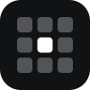

<h1 align="center">DeskTab</h1>

  <b>Trasforma un tablet in una superficie di controllo per il tuo PC Windows</b> 
  tasti, manopole e schermo a zone, in stile Stream Deck + XL

  <a href="https://github.com/rodriguesvlucas360-netizen/DeskTab-Updates/releases/latest"><b>⬇️ Scarica l'ultima versione</b></a> ·
  <a href="#-installazione-in-3-passi">Installazione</a> ·
  <a href="#-come-funziona">Come funziona</a> ·
  <a href="#-funzioni">Funzioni</a> ·
  <a href="#-aggiornamenti">Aggiornamenti</a> ·
  <a href="#-domande-frequenti">Domande</a>

  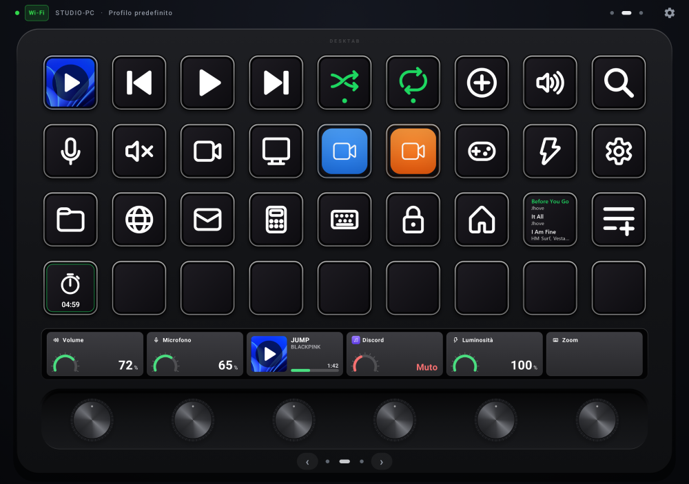

---

## ✨ In breve

| | |
|---|---|
| 🖥️ **Sul PC** | DeskTab per Windows 11: editor per creare tasti e profili, e il server a cui si collegano i tablet. |
| 📱 **Sul tablet** | App Android, oppure iPhone e iPad (dal browser o con l'app). Ogni tasto esegue un'azione sul PC. |
| 🔌 **Collegamento** | Wi-Fi sulla stessa rete o cavo USB (Android). Accoppiamento con un codice di 6 cifre. |
| 🎛️ **Integrazioni** | Spotify, Discord, monitor di sistema, misuratori audio, PowerPoint, Bitfocus Companion. |

---

## ⬇️ Download

Tutti i file sono nella pagina **[Release](https://github.com/rodriguesvlucas360-netizen/DeskTab-Updates/releases/latest)**. Il nome di ogni file contiene la sua versione.

| File | Per | A cosa serve |
|---|---|---|
| `DeskTab-<versione>.exe` | PC Windows 10/11 | Programma per il PC: editor e server (si installa da solo) |
| `DeskTab-Android-<versione>.apk` | Tablet e telefoni Android 8+ | App per Android |
| `DeskTab-iOS-<versione>.ipa` | iPhone e iPad (iOS 16+) | App nativa, da installare con Sideloadly |
| `<Plugin>-<versione>.desktabplugin` | PC | Plugin facoltativi (Spotify, Discord, Monitor di sistema, Misuratori audio, PowerPoint) |
| `version.json` | — | Usato dall'aggiornamento automatico (non va scaricato) |

> **Requisito sul PC:** Windows 10 o 11 a 64 bit. .NET è incluso nel programma: non serve installare altro.
> Se mancano, Windows lo segnala al primo avvio con un link per installarli.

---

## 🚀 Installazione in 3 passi

### 1. Sul PC

1. Scarica `DeskTab-<versione>.exe` e aprilo.
2. Alla domanda **«Vuoi installare DeskTab su questo PC?»** rispondi **Sì**:
   non servono permessi di amministratore. DeskTab compare nel menu Start, sul desktop e tra le app installate, e si avvia con Windows.
3. Al primo avvio Windows chiede l'accesso alla rete: scegli **Reti private**.

### 2. Sul tablet

| Dispositivo | Come |
|---|---|
| **Android** | Installa `DeskTab-Android-<versione>.apk` (permetti «Installa app sconosciute» quando Android lo chiede). |
| **iPhone / iPad: dal browser** *(consigliato)* | Sul PC apri *Impostazioni → iPhone e iPad*, inquadra il **codice QR**, apri in Safari e scegli *Condividi → Aggiungi alla schermata Home*. |
| **iPhone / iPad: app** | Installa `DeskTab-iOS-<versione>.ipa` con [Sideloadly](https://sideloadly.io) e il tuo Apple ID (con un ID gratuito va rinnovata ogni 7 giorni). |

### 3. Collega

Apri DeskTab sul tablet: il PC viene **trovato da solo** sulla rete. Tocca **Connetti** e scrivi il **codice di 6 cifre** che compare sul PC.
Da quel momento il tablet si ricollega da solo.

  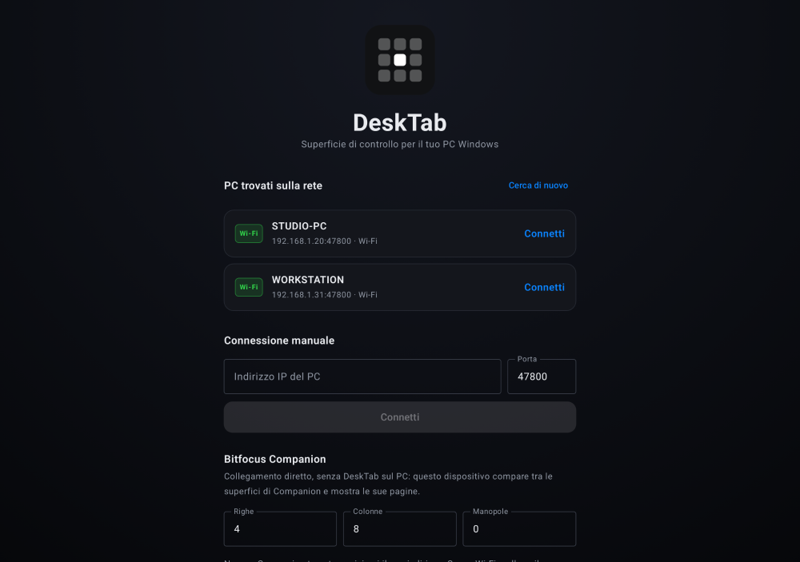
  &nbsp;
  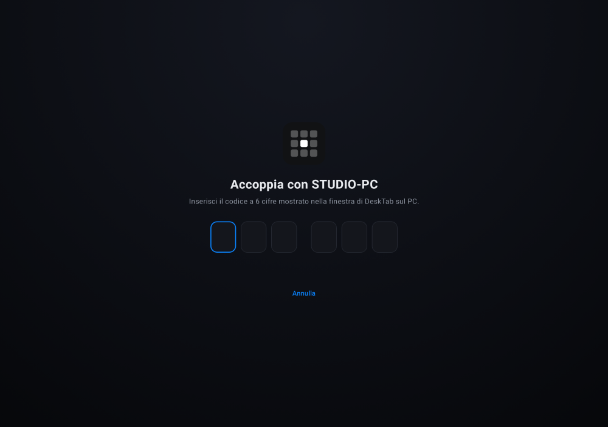

---

## 🧭 Come funziona

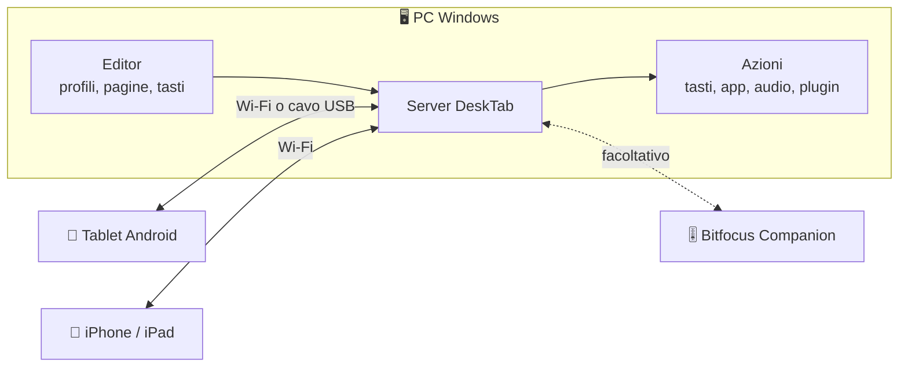

1. **Sul PC disegni il deck** nell'editor: scegli un'azione a destra e trascinala su un tasto.
2. **Il tablet mostra i tasti** con icone, titoli e immagini dal vivo (copertine, grafici, misuratori).
3. **Tocchi un tasto** → il tablet lo manda al PC → il PC esegue l'azione (scorciatoia, app, audio, comando di un plugin…) e
   il tasto mostra l'esito (✓ o ⚠).

  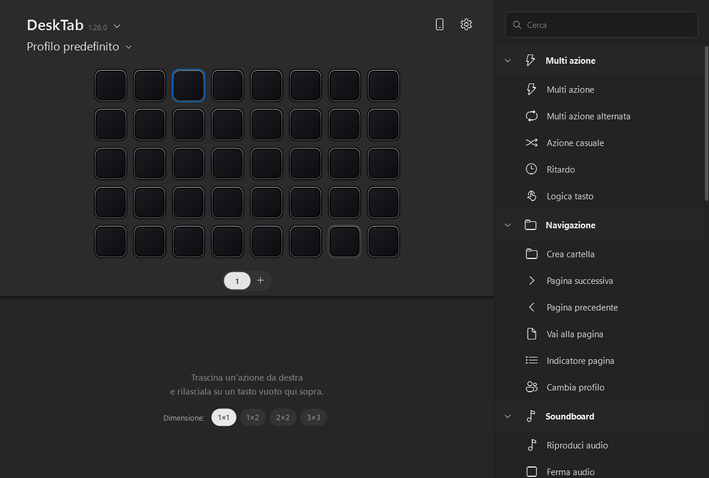

### Cosa si può mettere su un tasto

| Categoria | Esempi |
|---|---|
| **Sistema** | Scorciatoie da tastiera, apri app/file/cartelle/siti, scrivi testo, comandi, multimedia, blocca il PC |
| **Multi azione** | Più azioni in sequenza, con ritardi; azioni alternate; pressione / doppia / lunga |
| **Navigazione** | Cartelle, pagine, cambio di profilo |
| **Audio** | Soundboard, volume di sistema, microfono, volume delle singole app |
| **Schermo del PC** | Un monitor o una sola finestra del PC dentro il deck, da toccare |
| **Plugin** | Spotify, Discord, Monitor di sistema, Misuratori audio, PowerPoint |
| **Companion** | Pulsanti e manopole di Bitfocus Companion |

---

## 🎛️ Funzioni

<table>
<tr>
<td width="50%" valign="top">

### Tasti grandi e larghi
Un tasto può occupare 1×2, 2×2 o 3×3 celle: ideale per copertine, grafici e pulsanti importanti.

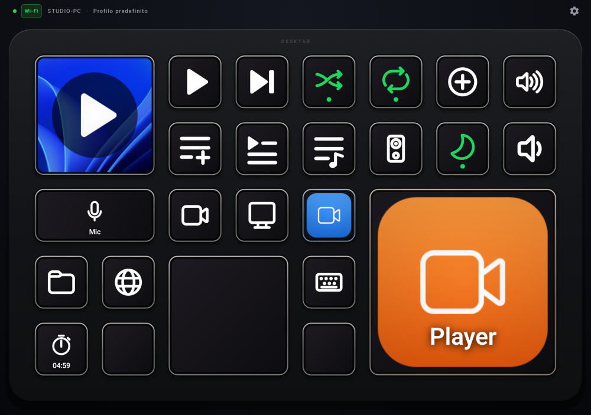
</td>
<td width="50%" valign="top">

### Cinque stili dei tasti
Cornice nera lucida, acrilico, vetro smerigliato, vetro liquido, neumorfismo: si sceglie dalle impostazioni del tablet.

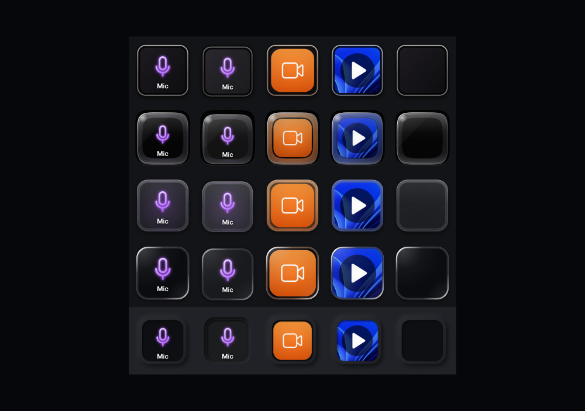
</td>
</tr>
<tr>
<td valign="top">

### Impostazioni sul deck
Un pannello a sezioni sopra i tasti: si vede subito l'effetto di ogni cambio.

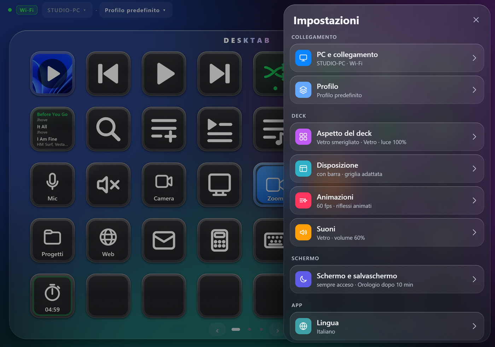
</td>
<td valign="top">

### Orizzontale e verticale
La griglia si adatta alla rotazione del tablet.

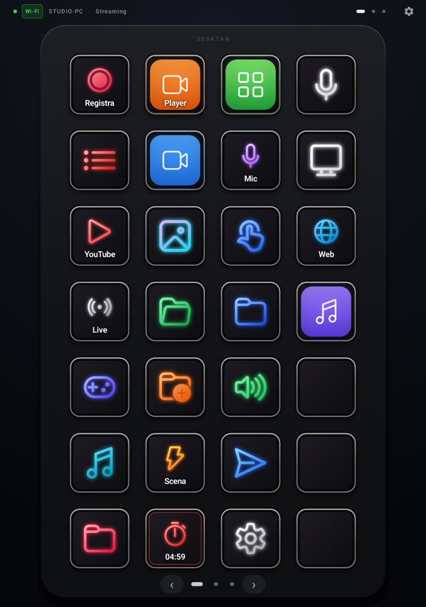
</td>
</tr>
</table>

- **Manopole e schermo a zone** come lo Stream Deck +: volume, microfono, app del mixer, Spotify, scorrimento, scorciatoie.
- **Profili e pagine**, con **profili automatici** che cambiano da soli in base all'app in primo piano.
- **Monitor del PC sul tablet**: duplica uno schermo o estendi il desktop sul tablet, con tocchi e penna.
- **Più PC insieme**: lo stesso tasto può comandare due o più PC nello stesso istante (es. presentazione principale e di riserva).
- **Bitfocus Companion**: il tablet diventa una superficie di Companion, anche senza DeskTab sul PC.
- **Salvaschermo, suoni e vibrazione**, multi-touch, tre lingue (italiano, português, English).

---

## 🔄 Aggiornamenti

DeskTab si aggiorna da solo: non serve tornare su questa pagina.

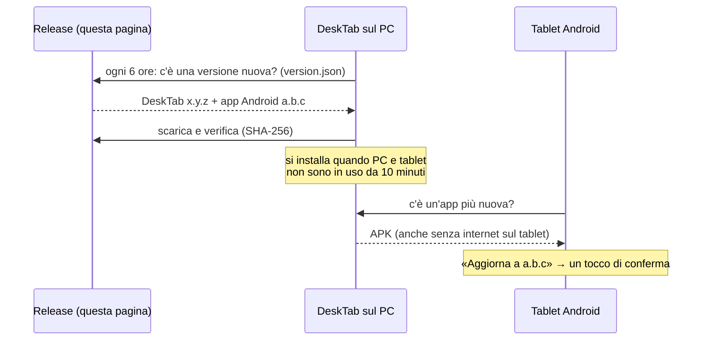

| Dove | Come si regola |
|---|---|
| **PC** | *Impostazioni → Informazioni → Aggiornamenti*: «Cerca le versioni nuove ogni 6 ore», «Scarica e installa da solo», pulsante «Cerca aggiornamenti» / «Installa ora». |
| **Android** | *Impostazioni → Lingua e informazioni → Aggiornamenti*: «Scarica gli aggiornamenti da solo». Quando una versione è pronta compare **«Aggiorna a …»** in alto: un tocco e Android chiede la conferma. |
| **iPhone / iPad** | Dal browser: sempre aggiornato insieme al PC. App: reinstalla l'`.ipa` nuovo con Sideloadly. |

Profili, tasti, plugin e accoppiamenti **restano** dopo ogni aggiornamento.

---

## ❓ Domande frequenti

<b>Il tablet non trova il PC</b>

- Tablet e PC devono essere sulla **stessa rete** (non una rete ospiti).
- Al primo avvio di DeskTab, Windows deve aver permesso la rete **privata**: *Impostazioni di Windows → Rete → Proprietà → Rete privata*.
- Puoi collegarti a mano con l'indirizzo che DeskTab mostra in *Impostazioni → Indirizzi per connessione manuale*.

<b>Posso usare il cavo USB invece del Wi-Fi?</b>

Sì, con Android: attiva *Opzioni sviluppatore → Debug USB* sul tablet e collegalo. DeskTab crea da solo il collegamento
(se manca `adb`, lo scarica da *Impostazioni → Collegamento via cavo USB*). Il tablet passa al cavo in un secondo e torna
al Wi-Fi quando lo stacchi.

<b>Perché per il cavo serve il Debug USB? È sicuro?</b>

È una domanda giusta. Android non permette a un'app normale di comunicare con il PC attraverso il cavo: l'unico canale
disponibile è quello di sviluppo (`adb`), che si accende con il *Debug USB*. DeskTab lo usa solo per far passare dal cavo la
stessa connessione che usa in Wi-Fi e per aprire l'app quando colleghi il tablet. Non legge i tuoi file e non cambia niente
sul dispositivo.

La prima volta Android chiede se autorizzare quel PC (*«Consentire il debug USB?»*): un computer che non hai autorizzato non
può fare niente. Per stare tranquillo autorizza solo il tuo PC, non collegare il tablet a computer di cui non ti fidi con il
debug acceso e spegnilo quando non usi il cavo. In *Opzioni sviluppatore* puoi anche revocare tutte le autorizzazioni date.

**Preferisci non attivarlo?** Nessun problema: in **Wi-Fi** DeskTab funziona senza Debug USB e con tutte le funzioni (tasti,
manopole, monitor sul tablet). Il cavo è solo un'alternativa per chi non ha una rete a disposizione.

<b>Android dice «app non installata» o chiede un permesso</b>

La prima volta va permesso *Installa app sconosciute* per l'app da cui apri l'APK (browser o file manager) e, per gli
aggiornamenti dal PC, per DeskTab stesso. Gli aggiornamenti mantengono accoppiamenti e impostazioni.

<b>Come installo un plugin?</b>

Scarica il file `.desktabplugin` e aprilo con un doppio clic (oppure *Impostazioni → Plugin → Installa plugin…*).

<b>È sicuro?</b>

Solo i dispositivi accoppiati con il codice mostrato sul PC possono comandarlo. Ogni dispositivo si può revocare da
*Impostazioni → Dispositivi*. Gli aggiornamenti scaricati vengono controllati con SHA-256 prima dell'installazione.

<b>Come si disinstalla?</b>

Da *Impostazioni di Windows → App installate → DeskTab → Disinstalla*. Puoi scegliere se tenere profili e impostazioni.

---

  Questo repository contiene solo le versioni pronte da installare. Novità di ogni versione nelle <a href="https://github.com/rodriguesvlucas360-netizen/DeskTab-Updates/releases">Release</a>.

